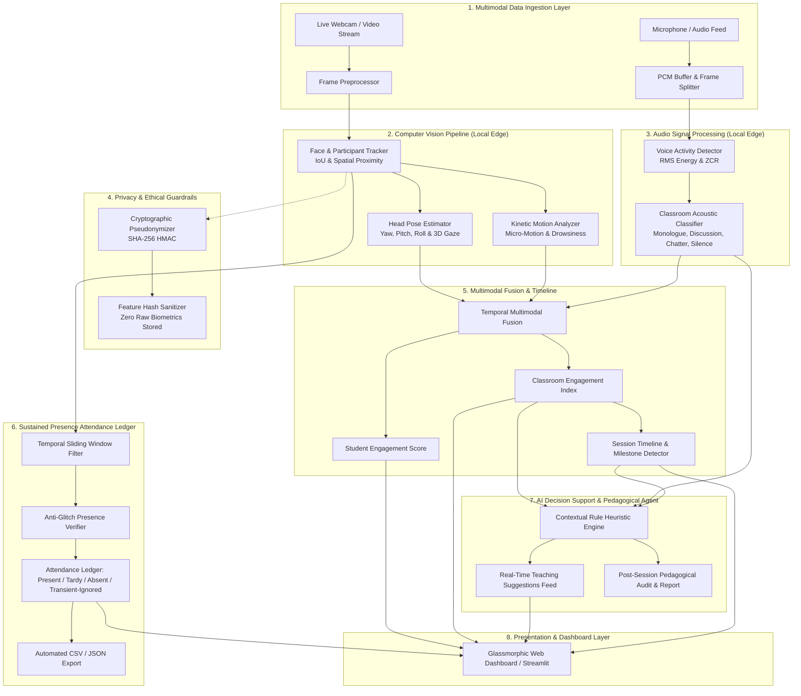

# 📐 Technical Architecture Specification

### System: Multimodal Attendance & Engagement Agent
**Architecture Paradigm:** Multimodal Edge AI, Privacy-First Architecture, Real-Time Decision Support  
**Operational Mode:** 100% Offline Capable, Zero-Cloud Telemetry Retention  

---

## 1. High-Level System Architecture Diagram

---

## 2. Mathematical Formulations & Algorithms

### 2.1 Sustained Presence Verification (Scenario 1)
To eliminate false positives caused by passersby (e.g., someone walking past an open door for 3 seconds) or momentary facial detection glitches:

$$\text{Active Time } T_{\text{active}}(i) = \sum_{t=t_0}^{t_{\text{now}}} \mathbb{I}(\text{student } i \text{ visible at frame } t) \cdot \Delta t$$

$$\text{Presence Ratio } R_p(i) = \frac{T_{\text{active}}(i)}{\max(t_{\text{now}} - t_{\text{start}}, \Delta t)}$$

$$\text{Status}(i) = \begin{cases}
\text{TRANSIENT\_IGNORED} & \text{if } T_{\text{active}}(i) < T_{\text{sustained}} \text{ and } (t_{\text{now}} - t_{\text{start}}) > T_{\text{sustained}} \\
\text{TARDY} & \text{if } T_{\text{active}}(i) \ge T_{\text{sustained}} \text{ and } t_{\text{first}}(i) > T_{\text{grace}} \\
\text{PRESENT} & \text{if } T_{\text{active}}(i) \ge T_{\text{sustained}} \text{ and } R_p(i) \ge R_{\min} \\
\text{ABSENT} & \text{otherwise}
\end{cases}$$

---

### 2.2 Visual Behavioral Dynamics (Scenario 2)

#### Head Pose Gaze Focus Score ($G \in [0, 1]$):
$$\text{Penalty}_{\text{yaw}} = \left(\frac{|\text{yaw}|}{60^\circ}\right)^{1.5}, \quad \text{Penalty}_{\text{pitch}} = \left(\frac{|\text{pitch}|}{45^\circ}\right)^{1.5}$$

$$G = \max\left(0.0, \, 1.0 - 0.6 \cdot \text{Penalty}_{\text{yaw}} - 0.4 \cdot \text{Penalty}_{\text{pitch}}\right)$$

#### Posture Stability Score ($M \in [0, 1]$):
$$\Delta c = \sqrt{\left(\frac{\Delta x}{w}\right)^2 + \left(\frac{\Delta y}{h}\right)^2} \Big/ \Delta t$$
$$\text{Kinetic Energy } E_k = \alpha E_{k, t-1} + (1 - \alpha) \min(1.0, 0.15 \cdot \Delta c)$$
$$M = \max\left(0.0, \, 1.0 - 1.5 \cdot |E_k - 0.25|\right)$$

#### Drowsiness Condition:
$$\text{is\_drowsy} = \left(\text{inactivity\_duration} \ge 12.0\text{s}\right) \land \left(\text{pitch} < -20^\circ \lor E_k < 0.05\right)$$

---

### 2.3 Acoustic Dynamics & Voice Activity Detection (VAD)

$$\text{RMS Energy} = \sqrt{\frac{1}{N} \sum_{n=1}^N x[n]^2}$$

$$\text{Zero Crossing Rate (ZCR)} = \frac{1}{2(N-1)} \sum_{n=1}^{N-1} \big| \text{sgn}(x[n]) - \text{sgn}(x[n-1]) \big|$$

$$\text{Speech Presence} = (\text{RMS} \ge \tau_{\text{RMS}}) \land (\text{ZCR}_{\min} \le \text{ZCR} \le \text{ZCR}_{\max})$$

---

### 2.4 Multimodal Fusion Model

$$E_{\text{base}} = w_g \cdot G + w_h \cdot H + w_m \cdot M + w_a \cdot A_{\text{acoustic}}$$

$$E_{\text{student}} = \max\left(0, \min\left(100, \left(E_{\text{base}} - P_{\text{drowsy}} \cdot \mathbb{I}_{\text{drowsy}} - P_{\text{distract}} \cdot \mathbb{I}_{\text{distract}}\right) \times 100\right)\right)$$

Where default calibrated weights:
- Gaze alignment $w_g = 0.35$
- Head pose stability $w_h = 0.25$
- Body kinetic activity $w_m = 0.20$
- Acoustic relevance $w_a = 0.20$
- Drowsiness penalty $P_{\text{drowsy}} = 0.45$
- Distraction penalty $P_{\text{distract}} = 0.30$

---

## 3. Privacy-Preserving Architecture

1. **Zero Raw Video Persistence:** Raw camera frames are analyzed in memory and immediately discarded. Never written to permanent storage.
2. **Cryptographic Pseudonymization:** Students' real names are deterministically salted and hashed using HMAC-SHA256 (`Learner-XXXX`).
3. **Perceptual Feature Quantization:** Biometric embeddings and coordinate vectors are quantized and one-way hashed before audit export.
4. **On-Premise Execution:** Operates entirely offline with no telemetry transmitted to third-party cloud servers.
