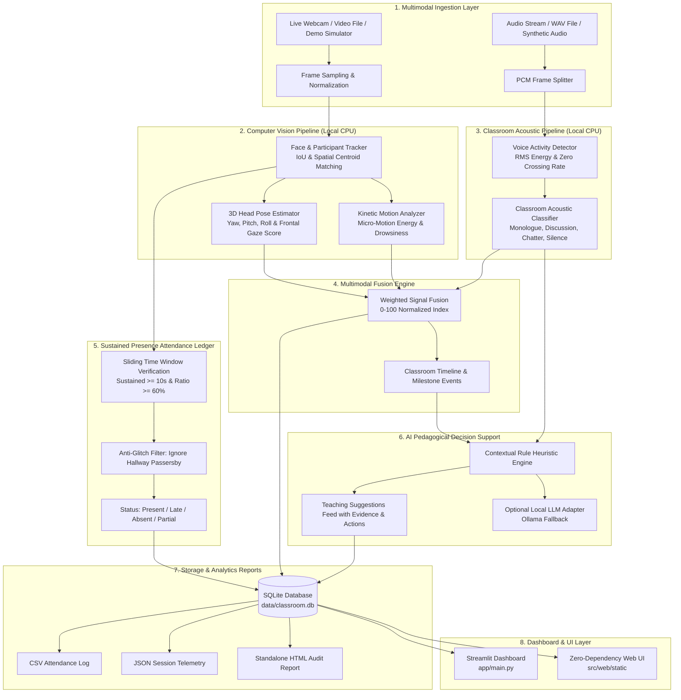

# 🎓 Multimodal Attendance & Engagement Agent
### AI-Powered, Privacy-Preserving, Fully Offline Classroom Intelligence System

[](https://www.python.org/)
[](#-privacy--ethical-framework)
[](#-automated-testing)
[](EPICS_AND_TASKS.md)

---

## 📌 Executive Summary

The **Multimodal Attendance & Engagement Agent** is an AI-powered, privacy-preserving classroom intelligence system. It automatically tracks attendance via **sustained presence verification**, computes continuous **multimodal engagement trends**, provides **context-aware AI teaching suggestions**, and produces rich **student session analytics**.

Engineered to operate **100% offline** on standard CPU hardware (Intel Core i5 8th Gen / 8 GB RAM), the system enforces strict privacy safeguards, zero cloud telemetry, and complete data sovereignty.

---

## 📐 System Architecture



---

## 🎯 Core Features & Scenarios

### 1. Automated Attendance Tracking
- **Inputs:** Live webcam feed (`--cam 0`), recorded video file (`--video sample.mp4`), or synthetic classroom stream (`--demo`).
- **Sustained Presence Logic:** Marks attendance based on continuous observation ($\ge 10\text{s}$ and $\ge 60\%$ ratio). Momentary appearances (e.g. hallway passerby visible for 3s) are automatically filtered out as `TRANSIENT_IGNORED`.
- **Status Classification:** `PRESENT`, `LATE` (arrival after grace period), `PARTIAL`, `ABSENT`.
- **Exports:** Automatic persistence to SQLite database and export to CSV and JSON.

### 2. Engagement & Session Dynamics Analysis
- **Head Pose & 3D Gaze Orientation:** Estimates Yaw, Pitch, and Roll to measure attention toward the front whiteboard vs. looking at neighbors or smartphone/desk.
- **Kinetic Motion & Drowsiness:** Tracks inter-frame motion energy; detects sustained downward immobility ($>12\text{s}$) to flag drowsiness.
- **Classroom Acoustics:** Frame-level Voice Activity Detection (RMS + ZCR) classifies instructional dynamics: `TEACHER_MONOLOGUE`, `STUDENT_DISCUSSION`, `CHATTER_SURGE`, `SUSTAINED_SILENCE`.
- **Fused Engagement Metric:** Calibrated weighted score ($0\text{--}100$) combining gaze alignment (0.35), head pose stability (0.25), motion stability (0.20), and acoustic relevance (0.20), with penalties for drowsiness and persistent distraction.

### 3. AI-Driven Teaching Suggestions
- Pedagogical decision-support engine delivers real-time, non-intrusive recommendations:
  - *Monologue Fatigue (>90s):* Recommends pausing for a 2-minute Think-Pair-Share.
  - *Attention Dip (<50%):* Suggests an interactive formative check-in poll.
  - *Classroom Dead Silence (>20s):* Recommends scaffolding hints or true/false formulation.
  - *Student Drowsiness:* Suggests a physical stretch break.
- **Strictly Assistive:** Never enforces decisions, never ranks or punishes students.
- **Optional Local LLM:** Includes an Ollama adapter (`src/agent/local_llm.py`) disabled by default with graceful fallback.

### 4. Student Session Analytics & Reporting
- **Per-Student Reports:** Presence duration, focus score, attention category (High/Moderate/Low), and low-attention interval breakdown.
- **Session Reports:** Overall engagement letter grade (A–D), monologue vs. discussion ratio, and action plans.
- **Formats:** Standalone HTML reports with inline styling, CSV logs, and JSON telemetry.

### 5. Multi-Page Streamlit Dashboard
- 🎥 **Live & Video Session:** Live spatial seating HUD, radial engagement gauge, real-time alert feed.
- 📋 **Attendance Ledger:** Filterable student roll call, search bar, CSV/HTML download buttons.
- 📈 **Engagement Timeline:** Interactive timeseries line charts, milestone event markers, acoustic breakdown.
- 👤 **Student Analytics:** Individual focus profiles and low-attention interval lists.
- 💡 **Teaching Suggestions:** Evidence-based pedagogical advisory feed.
- ⚙️ **Settings & Privacy:** Anonymization toggle, face blurring, weight adjustment sliders, and data retention purge.

---

## 📁 Project Structure

```
multimodal-attendance-engagement-agent/
├── app/
│   └── main.py                        # Multi-page Streamlit Dashboard
├── config/
│   ├── config.yaml                    # System thresholds, weights, and settings
│   └── default_config.yaml            # Fallback configuration
├── data/
│   ├── classroom.db                   # SQLite database (sessions, attendance, samples)
│   ├── sample_roster.json             # Enrolled student roster
│   ├── sample_session.wav             # Synthesized classroom audio track
│   └── logs/                          # Output CSVs, JSONs, and HTML reports
├── scripts/
│   ├── run_session.py                 # Main session execution CLI
│   ├── generate_demo_data.py          # Synthetic dataset & session generator
│   ├── run_dashboard.bat              # One-click Windows dashboard launcher
│   ├── run_demo.bat                   # One-click Windows simulation demo
│   └── run_tests.bat                  # One-click Windows test runner
├── src/
│   ├── agent/
│   │   ├── decision_rules.py          # Pedagogical heuristic rule engine
│   │   ├── local_llm.py               # Optional local LLM adapter (Ollama)
│   │   └── teaching_agent.py          # Decision-support advisor & session auditor
│   ├── attendance/
│   │   └── attendance_manager.py      # Sustained presence ledger & anti-glitch filter
│   ├── audio/
│   │   ├── acoustic_classifier.py     # Classroom acoustic dynamic classifier
│   │   ├── synthetic_audio.py         # Audio synthesizer & WAV processor
│   │   └── vad.py                     # RMS energy & Voice Activity Detection
│   ├── config.py                      # Strongly-typed configuration loader
│   ├── fusion/
│   │   ├── multimodal_fusion.py       # Calibrated multimodal engagement index
│   │   └── session_timeline.py        # Timeseries timeline & milestone detector
│   ├── privacy/
│   │   └── anonymizer.py              # HMAC-SHA256 pseudonymizer & telemetry scrubber
│   ├── reports/
│   │   └── report_generator.py        # Standalone HTML, JSON, and Markdown reports
│   ├── storage/
│   │   ├── database.py                # SQLite models & retention cleanup
│   │   └── exporter.py                # CSV and JSON export pipelines
│   └── vision/
│       ├── face_tracker.py            # Spatial multi-object tracker
│       ├── head_pose.py               # 3D Euler angles & frontal gaze focus
│       ├── motion_analyzer.py         # Kinetic energy & drowsiness detector
│       └── synthetic_video.py         # Video stream simulator & persona generator
├── tests/                             # 35 Unit and integration tests (100% passing)
├── ARCHITECTURE.md                    # In-depth architectural & mathematical design
├── EPICS_AND_TASKS.md                 # 9 Epics and 17 Tasks tracking specification
├── ETHICS.md                          # Limitations, bias risks, & non-punitive guidelines
├── requirements.txt                   # Dependency manifest
└── pyproject.toml                     # Modern package manifest
```

---

## 🚀 Quick Start Guide

### 1. Run the Multi-Page Streamlit Dashboard
```bash
streamlit run app/main.py
```
*(Or use the zero-dependency built-in server: `python main.py dashboard --port 8080`)*

### 2. Run a Classroom Session via CLI
```bash
# Run simulation demo
python scripts/run_session.py --demo --duration 30

# Run with a recorded video file
python scripts/run_session.py --video sample.mp4 --name "Biology Lecture"

# Run with live camera (webcam index 0)
python scripts/run_session.py --cam 0 --duration 60 --anonymize
```

### 3. Generate Rich Offline Demo History
```bash
python scripts/generate_demo_data.py
```
Prepopulates the SQLite database with 3 historical sessions, student rosters, timeseries curves, and exports HTML reports.

### 4. Run the Full Test Suite (35 Tests)
```bash
python main.py test
```
*Or using pytest:*
```bash
pytest tests/ -v
```

---

## ⚖️ Privacy & Ethical Framework

- **100% Local Processing:** Zero cloud APIs or telemetry transmissions.
- **Zero Video Persistence:** Raw camera frames are analyzed in RAM and immediately discarded.
- **Cryptographic Pseudonymization:** Students' names can be automatically replaced with salted hashes (`Student_01` or `Learner-XXXX`).
- **Data Retention Limit:** Automated purge deletes telemetry older than $N$ days (`storage.retention_days`).
- **Assistive, Non-Punitive Policy:** Engagement scores are behavioral estimates, not evaluations of intelligence or worth. See [`ETHICS.md`](ETHICS.md).

---

## ⚠️ Known Limitations
1. **Extreme Angles:** Peripheral seats in wide lecture halls can reduce head pose precision; front-facing camera positioning is recommended.
2. **Lighting Sensitivities:** Severe underexposure or direct backlighting can impact facial landmark detection.
3. **Acoustic Reverberation:** Large echoey auditoriums may require adjusting `audio.vad_rms_threshold` in `config/config.yaml`.
